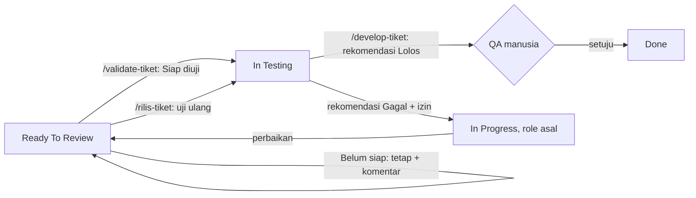
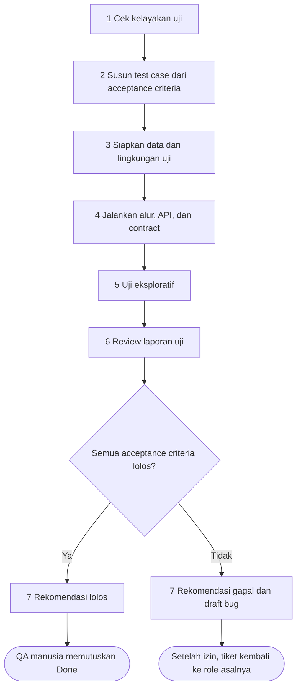

# Alur kerja

## Papan kanban
Workflow QA bekerja di ruas **Ready To Review → rekomendasi Done**. Ruas Todo → Ready To Review milik workflow delivery role asal tiket (Mobile, Frontend web, Backend).

| | Ready To Review | In Testing (opsional) | Done | Kembali ke In Progress |
| --- | --- | --- | --- | --- |
| **Perintah QA** | `/validate-tiket` | `/develop-tiket`, `/rilis-tiket` | — | — |
| **Dipindah oleh** | workflow delivery | agen QA, bila **Siap diuji** dan board punya kolom ini | **QA manusia saja** | agen QA **hanya setelah izinmu per tiket** |
| **Bukti** | — | laporan kelayakan uji | laporan uji + rekomendasi Lolos | rekomendasi Gagal + draft bug |

- Agen **tidak pernah** memindah tiket ke Done atau menutup issue; guard memblokirnya.
- Agen tidak membuat tiket bug dan tidak mengembalikan tiket sendiri: keduanya mengubah pekerjaan role lain, jadi selalu ditanyakan dulu.

## Skill flow dan skill set
Tiap perintah adalah **skill flow** yang menjalankan **skill internal** berurutan. Skill internal tidak saling memanggil, jadi urutan kerja selalu terlihat dari flow-nya. Skill internal juga bisa dipanggil sendiri bila perlu (mis. `/check-build PROJ-1234`).

| Skill flow | Skill set, berurutan |
| --- | --- |
| `/validate-tiket` | `/setup-board`, `/setup-docs`, `/read-ticket`, `/check-testable`, `/check-build`, `/find-related`, `/write-report`, `/post-decision` |
| `/develop-tiket` | `/gate-validation`, `/design-tests`, `/prepare-data`, `/run-flow`, `/run-automation`, `/check-contract`, `/explore-edge`, `/review-code`, `/draft-bug`, `/write-report`, `/post-verdict` |
| `/rilis-tiket` dan `/branch-manager --rilis` | `/read-feedback`, `/retest-fix`, `/run-regression`, `/smoke-live`, `/write-signoff` |
| `/audit-issue` | `/split-questions`, `/reproduce-issue`, `/compare-attachments`, `/write-report` |

| Skill khas QA | Tugas |
| --- | --- |
| `/check-testable` | Memeriksa apakah tiap AC terukur dan punya hasil yang diharapkan |
| `/check-build` | Memastikan build/deploy tersedia dan versinya cocok dengan PR/MR tiket |
| `/design-tests` | Menyusun test case dari AC: alur normal, nilai batas, alur gagal |
| `/prepare-data` | Menyiapkan data uji berawalan kode tiket |
| `/run-flow` | Menjalankan alur di device, browser, atau API, dan mengambil bukti |
| `/run-automation` | Menjalankan otomasi yang ada, dan menambah otomasi untuk test case baru |
| `/explore-edge` | Uji eksploratif di luar AC, dengan batas waktu |
| `/draft-bug` | Menulis draft bug: langkah, hasil, harapan, bukti, keparahan |
| `/post-verdict` | Menulis rekomendasi lolos/gagal di komentar tiket, tanpa menggeser ke Done |
| `/retest-fix` | Menguji ulang test case yang gagal setelah perbaikan |
| `/write-signoff` | Menulis rekomendasi rilis beserta risiko yang tersisa |
| `/reproduce-issue` | Mencoba mereproduksi keluhan dari lapangan |

Skill bersama dengan workflow delivery (nama sama, isi disesuaikan QA): `/setup-board`, `/setup-docs`, `/read-ticket`, `/find-related`, `/write-report`, `/post-decision`, `/gate-validation`, `/check-contract`, `/review-code`, `/read-feedback`, `/run-regression`, `/smoke-live`, `/split-questions`, `/compare-attachments`. Di workflow ini `/review-code` me-review **laporan uji**, bukan kode.

## `/validate-tiket`
Cek tiket siap diuji. Hasil: `docs/tickets/<KODE>/qa-validasi.md` + komentar tiket.

| Keputusan | Artinya | Tiket |
| --- | --- | --- |
| **Siap diuji** | Semua AC terukur, build cocok dengan PR/MR, data ada | ke In Testing (bila ada kolomnya) |
| **Siap dengan catatan** | Bisa diuji sebagian; catatan jadi test case atau Tertahan | ke In Testing (bila ada kolomnya) |
| **Belum siap** | Build tidak ada/tidak cocok, AC inti kabur | tetap, + komentar apa yang dibutuhkan |

`--tim`: PdM (AC vs dokumen bisnis), Contract Runner (build + contract), PjM (tiket/bug terkait) bekerja paralel; Validator menulis satu laporan.

## `/develop-tiket`
Di QA, "mengerjakan tiket" berarti **menguji tiket**. Tujuh langkah; hasil akhirnya rekomendasi, bukan keputusan.

| # | Langkah | Siapa | Hasil |
| --- | --- | --- | --- |
| 1 | Baca laporan kelayakan uji, AC, dan contract | SPV | Gerbang lolos dan daftar yang diuji |
| 2 | Susun test case **tanpa membaca rencana kerja dan diff** | Planner | Daftar test case per AC |
| 3 | Siapkan data uji, pastikan build/deploy yang benar terpasang | QA | Lingkungan siap |
| 4 | Jalankan alur layar, API, dan contract | QA | Bukti per test case |
| 5 | Uji eksploratif dengan batas waktu | QA | Temuan di luar AC |
| 6 | Periksa bahwa setiap AC punya bukti | Reviewer | Laporan lolos review |
| 7 | Tulis rekomendasi dan draft bug di komentar tiket | Release | Rekomendasi lolos atau gagal |

| Flag | Artinya |
| --- | --- |
| `--solo` / `--tim` | Satu agen / tim (Planner, QA 1–3, Reviewer, Release). Tanpa flag: tiket kecil satu role = solo |
| `--batch` (default) | Tiket di build yang sama diuji bersama: pasang build sekali per device, laporan tetap per tiket |
| `--separate` | Tiap tiket jalur sendiri |
| `--uat` | Setelah review: sesi uji bersama pemilik produk atau pengguna; tanggapan mereka dicatat sebagai temuan |

Langkah 1–5 berjalan dalam **mode buta**: guard memblokir perintah yang membuka isi diff, supaya test case tidak mewarisi asumsi Coder. Laporan `qa.md` harus lolos `qa-check.py report --final` sebelum rekomendasi dikirim.

## `/rilis-tiket`
Per tiket yang sudah pernah diuji. `/read-feedback` membaca komentar terbaru, lalu:

| Keadaan | Tindakan |
| --- | --- |
| Developer bilang sudah diperbaiki, ada build baru | `/retest-fix`: TC yang gagal diuji ulang, TC lain dicek singkat, eksploratif singkat → review → rekomendasi baru |
| Done oleh QA manusia / tanpa feedback | Lapor saja |
| Feedback bertentangan / bug ditolak developer | Tanya kamu |

## `/branch-manager --rilis`
Per versi. `/run-regression` (suite penuh di build kandidat), `/smoke-live` (hanya dengan `--smoke`, setelah versi live, baca saja), lalu `/write-signoff` → `docs/rilis/vX.Y.Z-qa.md` + komentar di tiket rilis.

| Rekomendasi rilis | Syarat |
| --- | --- |
| **Layak rilis** | Semua tiket Lolos, regresi dan smoke Lulus |
| **Layak dengan risiko** | Ada yang Tertahan/belum diuji/smoke belum jalan, tanpa Gagal; risiko ditulis |
| **Tidak layak rilis** | Ada tiket/regresi/smoke Gagal atau bug S1–S2 terbuka |

QA tidak merge PR rilis, tidak upload, dan tidak membuat tag.

## `/audit-issue`
Keluhan yang belum jadi tiket. `/split-questions` memecahnya jadi pertanyaan, Auditor `/reproduce-issue` di build yang sudah ada, Analis `/compare-attachments` dengan lampiran. Hasil: bisa direproduksi **Ya / Tidak / Kadang** + saran tiket (tidak dibuat). Selama audit, guard memblokir semua penulisan.

---
[← kembali ke README](../README.md)
