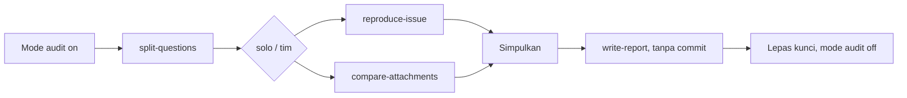

Audit keluhan di `$ARGUMENTS`: teks dalam tanda kutip, flag `--solo`/`--tim` (opsional), lalu path/link lampiran. Peranmu = **SPV audit**. Audit **hanya-baca**: tidak mengubah repo, tidak membuat/mengomentari/memindah tiket. Guard memaksanya selama mode audit menyala.

Baca dulu: `~/.agent-workflow/qa-repo/skills/_shared/rules.md`, `tools.md`, `credentials.md`, `report-format.md` (→ Laporan audit), `~/.agent-workflow/qa-repo/agents/{qa-auditor,qa-analis}.md`. Skill internal = `~/.agent-workflow/qa-repo/skills/<nama>/SKILL.md`.

## Langkah
0. `export QA_WORKFLOW_DIR="$(cd ~/.agent-workflow/qa-repo && pwd -P)"`; `AGENT_LOCK_PID=$PPID "$QA_WORKFLOW_DIR/bin/qa-mode.sh" audit on`. Slug = `<yyyymmdd-hhmm>-<3 kata pertama keluhan, huruf kecil, spasi → ->`; `mkdir -p "${TMPDIR:-/tmp}/qa/audit/<slug>"`. Semua berkas kerja hanya di sana.
1. Baca semua lampiran (yang ditempel di chat hanya terlihat sesi ini: telaah sendiri, beri worker ringkasannya). `split-questions`.
2. **Solo:** sesi ini menjalankan `reproduce-issue` lalu `compare-attachments`. **Tim:** teammate Auditor (Engkos, Kardi; satu per platform/browser, `claude-opus-5-5`) untuk `reproduce-issue`, Analis (Bu Warsih, `claude-opus-5-5`) untuk `compare-attachments` bila ada lampiran. Teammate otomatis ikut mode audit.
3. **Simpulkan:** gabungkan `${TMPDIR:-/tmp}/qa/audit/<slug>/*.md`: bisa direproduksi **Ya** / **Tidak** / **Kadang**, kondisi pemicu, dampak, keyakinan (**pasti** / **kuat** / **dugaan**). Klaim tanpa bukti ditulis sebagai dugaan.
4. **Laporan** (template `templates/audit.md`, format `report-format.md` → Laporan audit) + saran tiket (tidak dibuat): judul, langkah, harapan, keparahan S1–S4. `write-report` dalam mode audit: tanpa commit/push.
5. Hentikan semua teammate, lepas kunci device/akun, lalu `AGENT_LOCK_PID=$PPID "$QA_WORKFLOW_DIR/bin/qa-mode.sh" audit off` (panggilan Bash tersendiri). Di chat: link/isi laporan + satu kalimat kesimpulan.

## Tidak pernah
- Membuat, mengedit, mengomentari, atau memindah tiket.
- Commit, checkout, branch, worktree, PR/MR, atau menulis ke repo lewat shell (guard tidak menangkap `sed -i`/`>`).
- Membangun build; data uji di produksi; login akun nyata pengguna.
