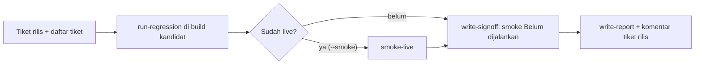

Siapkan rekomendasi QA untuk satu versi (`$ARGUMENTS`; `KODE-TIKET-RILIS` = tiket rilis tempat rekomendasi dikomentari). Sesi ini = **SPV** + **Release**. Rekomendasi, bukan keputusan: merge PR rilis, upload produksi, dan tag tetap di workflow rilis role asalnya dan di tangan manusia. Argumen lain → belum ada, berhenti dan tanya.

Baca dulu: `~/.agent-workflow/qa-repo/skills/_shared/rules.md`, `tools.md`, `credentials.md`, `report-format.md` (→ Rekomendasi rilis). Skill internal = `~/.agent-workflow/qa-repo/skills/<nama>/SKILL.md`.

## Langkah
0. `export QA_WORKFLOW_DIR="$(cd ~/.agent-workflow/qa-repo && pwd -P)"`; `AGENT_LOCK_PID=$PPID "$QA_WORKFLOW_DIR/bin/qa-mode.sh" qa on`; `setup-board`, `setup-docs`.
1. **Tiket rilis** (`read-ticket`): versi `vX.Y.Z`, build kandidat (beta/staging), daftar tiket dalam rilis (link tiket rilis, atau laporan rilis workflow delivery). Versi/build tidak jelas → tanya.
2. **Status QA per tiket**: rekomendasi terakhir + bug terbuka (komentar rekomendasi, `docs/tickets/<KODE>/qa.md` di `upstream/<protected>`). Tiket tanpa laporan QA → `belum diuji` (risiko); tawarkan `/develop-tiket` untuk tiket itu, jangan diuji diam-diam di sini.
3. **Build kandidat** (`check-build`: memuat commit rilis), lalu **regresi penuh** (`run-regression`): di mode tim, QA (1–3, `claude-opus-5-5`) dibagi per platform/browser; owner kunci `rilis-vX.Y.Z-qa<n>`.
4. **Smoke live** (`smoke-live`) hanya dengan `--smoke` dan setelah versi itu benar-benar live (tanya user bila ragu). Tanpa itu → `## Smoke live` = "Belum dijalankan" (risiko).
5. **Rekomendasi** (`write-signoff`) → `qa-check.py signoff` lolos → `write-report` (`docs/rilis/vX.Y.Z-qa.md` di branch `qa/rilis-vX.Y.Z`, atau platform dokumentasi) → komentar di tiket rilis: baris pertama link dokumen, lalu rekomendasi + jumlah risiko + tiket yang disarankan dikeluarkan (bila ada).
6. Bug baru dari regresi → izin per bug untuk dibuat tiket (`rules.md`).
7. Ringkasan ke user, lalu lepas kunci dan `qa-mode.sh qa off`:
   | Versi | Tiket (Lolos/Gagal/Belum) | Regresi | Smoke live | Rekomendasi | Risiko | Dokumen |
   |---|---|---|---|---|---|---|

**Larangan:** tidak merge PR rilis, tidak upload, tidak membuat/push tag, tidak memindah tiket mana pun ke Done.

## Berhenti lebih awal / galat
Device/akun/lingkungan tidak tersedia → tulis Tertahan + alasan di rekomendasi, jangan dianggap lulus. Lepas kunci dan matikan mode sebelum lapor.
