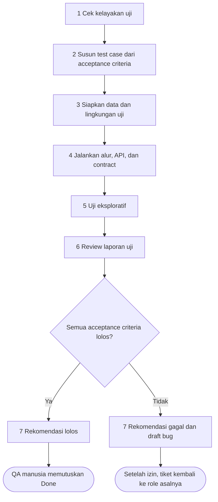

Di QA, "mengerjakan tiket" berarti **menguji tiket** (`$ARGUMENTS`). Hasil akhirnya **rekomendasi, bukan keputusan**: QA manusia yang memutuskan Done. Sesi ini = **SPV**: ikuti `~/.agent-workflow/qa-repo/agents/qa-spv.md`.

Baca dulu (jangan disalin ke sini): `~/.agent-workflow/qa-repo/skills/_shared/rules.md` (terutama Tiga aturan independensi), `tools.md`, `credentials.md`, `report-format.md`, serta `~/.agent-workflow/qa-repo/agents/{qa-planner,qa-tester,qa-reviewer,qa-release}.md`. Skill internal = baca dan ikuti `~/.agent-workflow/qa-repo/skills/<nama>/SKILL.md`. Setiap panggilan `device-lock.sh`/`device-pick.sh`/`qa-mode.sh` diawali `AGENT_LOCK_PID=$PPID` di panggilan Bash yang sama.

**Flag:**
- `--solo` / `--tim`: paksa satu agen atau tim. Tanpa flag: 1 tiket dengan ≤ 3 AC dan satu role = solo, selain itu tim.
- `--batch` (default): semua tiket yang ada di **build yang sama** diuji bersama: satu kali pasang build per device, satu putaran regresi area; laporan tetap per tiket. Tiket di build berbeda → otomatis kelompok terpisah.
- `--separate`: tiap tiket jalur sendiri (pasang, uji, laporan, rekomendasi).
- `--uat`: sesudah langkah 6, **sesi uji bersama pemilik produk atau pengguna** (langkah 6b).

| # | Langkah | Siapa | Skill | Hasil |
|---|---|---|---|---|
| 1 | Baca laporan kelayakan uji, AC, dan contract | SPV | `setup-board`, `setup-docs`, `read-ticket`, `gate-validation` (+ `check-testable`/`check-build` bila gerbang meminta) | Gerbang lolos dan daftar yang diuji |
| 2 | Susun test case tanpa membaca rencana kerja dan diff | Planner | `design-tests` | Daftar test case per AC |
| 3 | Siapkan data uji dan pastikan build/deploy yang benar terpasang | QA | `prepare-data` | Lingkungan siap |
| 4 | Jalankan alur layar, API, dan contract | QA | `run-flow`, `run-automation`, `check-contract`, `draft-bug` | Bukti per test case |
| 5 | Uji eksploratif dengan batas waktu | QA | `explore-edge`, `draft-bug` | Temuan di luar AC |
| 6 | Periksa bahwa setiap AC punya bukti | Reviewer | `review-code` | Laporan lolos review |
| 7 | Tulis rekomendasi dan draft bug di komentar tiket | Release | `write-report`, `post-verdict` | Rekomendasi lolos atau gagal |

## Langkah
0. **Mode:** `export QA_WORKFLOW_DIR="$(cd ~/.agent-workflow/qa-repo && pwd -P)"`; `AGENT_LOCK_PID=$PPID "$QA_WORKFLOW_DIR/bin/qa-mode.sh" qa on`.
1. **Gerbang (SPV):** `setup-board`, `setup-docs` (sekali), lalu per tiket `read-ticket` → `gate-validation`. Gerbang **cek singkat** → `check-testable` + `check-build` sekarang; **cek build ulang** → `check-build`; **berhenti** → tanya user, tiket lain jalan terus. Kelompokkan tiket per build (`--batch`). Lalu **`AGENT_LOCK_PID=$PPID "$QA_WORKFLOW_DIR/bin/qa-mode.sh" blind on`** — mulai sini sampai langkah 5, diff tidak dibuka siapa pun.
   - **Worktree QA** per tiket bila tiket butuh otomasi uji atau platform dokumentasi `docs/`: `rules.md` → Worktree QA (`<repo>-qa-<nomor>`, branch `qa/<KODE>` dari `upstream/<protected>`; branch project dari memory, belum ada → tanya, simpan).
2. **Test case (Planner):** brief = `gerbang.md` saja (AC, contract, desain, role, build, batasan). `design-tests` → `${TMPDIR:-/tmp}/qa/<KODE>/test-cases.md`. SPV memeriksa: tiap AC punya TC `normal`, TC `(fisik)` sesuai device yang ada; jatah device/akun dibagi per TC.
3. **Persiapan (QA):** `prepare-data` — versi build terpasang harus sama dengan gerbang. `--batch`: build dipasang **sekali per device**, semua tiket kelompok itu diuji di sana.
4. **Eksekusi (QA):** `run-flow` per TC; `check-contract` untuk tiket ber-role `api` atau TC contract; `run-automation` (suite area terdampak + otomasi baru dari TC yang stabil, di worktree QA); tiap TC yang ditandai untuk draft bug → `draft-bug`.
5. **Eksploratif (QA):** `explore-edge` dengan batas waktu; temuan berarti → `draft-bug`. QA menulis `qa.md` (template `templates/qa.md`), `qa-check.py report` lolos (tanpa `--final`). Lalu **`qa-mode.sh blind off`**.
6. **Review (Reviewer, bukan QA yang menguji):** `review-code`. Perlu revisi → kembali ke langkah 4/5 untuk TC itu; lebih dari 2 putaran → Planner merevisi test case. Lolos → `qa-check.py report --final` lolos.
6b. **UAT (`--uat`)**: SPV menyiapkan sesi uji bersama pemilik produk/pengguna: daftar skenario dari TC `normal` dalam bahasa awam, build + device/URL, akun uji (nama kunci). Device fisik dipindah ke user: QA ambil `device-pick.sh <plat> <KODE>-qa<n> --physical` + pasang build, lalu SPV `device-lock.sh move <res> <KODE>-qa<n> human-<KODE>`. User mencoba dan memberi tanggapan di chat; SPV mencatat tiap tanggapan sebagai baris `Temuan` di `## Uji eksploratif` (sumber: UAT) dan draft bug bila perlu, lalu `device-lock.sh release <res> human-<KODE>` saat user bilang selesai. Review ulang singkat bila ada temuan baru.
7. **Rekomendasi (Release):** `write-report` (dokumen tiket: `qa-check.py ticket <folder> --final`) → link laporan + Draft PR/MR `qa/<KODE>` bila ada otomasi/dokumen di repo; lalu `post-verdict`. Rekomendasi Gagal → tanya izin per bug dan per tiket (`rules.md` → Selalu berhenti dan tanya).
8. **Bersihkan & ringkas:** hapus worktree QA yang bersih dan sudah di-push (`rules.md` → Worktree QA); hentikan semua teammate; lepas semua kunci; `qa-mode.sh blind off` dan `qa-mode.sh qa off` (panggilan Bash tersendiri).
   | KODE | Rekomendasi | Build | Bug (keparahan) | Laporan | PR otomasi |
   |---|---|---|---|---|---|

## Mode tim
Tiap worker = teammate (tool Agent, `name: "<Nama>-<Label><n>"` dari tabel "Nama agen" di `rules.md`, `subagent_type` = nama agen `qa-<peran>`, `rules.md` → Orkestrasi). Prompt: "Ikuti `~/.agent-workflow/qa-repo/agents/<agen>.md`" + KODE, TC yang ditugaskan, jatah device/akun, folder kerja.
| Peran | Model | Catatan |
|---|---|---|
| Planner | `claude-fable-5-2` (jangan isi `model`: frontmatter yang berlaku) | langkah 2 dan revisi test case; dihentikan setelah membalas |
| QA (1–3) | `claude-opus-5-5` | beda keluarga model dari Coder workflow delivery; satu QA run per platform/browser |
| Reviewer | `claude-opus-5-5` | bukan QA yang menguji tiket itu |
| Release | `claude-haiku-5-5` | langkah 7 |
**Solo:** SPV menjalankan peran berurutan; susun test case (langkah 2) **sebelum** membuka apa pun dari PR/MR; laporan mencatat bahwa review bukan independen.

## Berhenti lebih awal / galat
Sebelum berhenti (guard, tanya, galat, user membatalkan): lepas semua kunci milik batch ini (device, akun, `human-<KODE>`, `checkout:*`), minta teammate melakukan hal sama lalu hentikan mereka, `qa-mode.sh blind off` + `qa-mode.sh qa off`, dan laporkan posisi terakhir per tiket.
