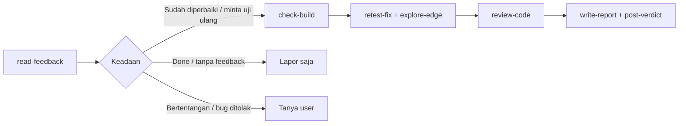

Tindak lanjuti tiket yang sudah pernah diuji (`$ARGUMENTS`). Sesi ini = **SPV** (solo) yang menjalankan peran QA, Reviewer, dan Release berurutan; dengan teammate bila lebih dari satu tiket butuh uji ulang. Rilis per versi bukan di sini: itu `/branch-manager --rilis`.

Baca dulu: `~/.agent-workflow/qa-repo/skills/_shared/rules.md`, `tools.md`, `credentials.md`, `report-format.md`. Skill internal = `~/.agent-workflow/qa-repo/skills/<nama>/SKILL.md`.

## Langkah
0. `export QA_WORKFLOW_DIR="$(cd ~/.agent-workflow/qa-repo && pwd -P)"`; `AGENT_LOCK_PID=$PPID "$QA_WORKFLOW_DIR/bin/qa-mode.sh" qa on`; `setup-board`, `setup-docs`.
1. **Per tiket:** `read-ticket` lalu `read-feedback` → tindakan dari tabelnya.
2. **Uji ulang**, berurutan: `qa-mode.sh blind on` → `check-build` (build baru wajib memuat commit terakhir PR/MR; tidak → berhenti dan tanya) → `prepare-data` → `retest-fix` → `explore-edge` (batas waktu setengah dari biasanya, di sekitar perbaikan) → `draft-bug` untuk tiap TC/temuan yang ditandai → `qa-mode.sh blind off` → `review-code` (agen yang bukan penguji bila tim) → `write-report` (`qa-check.py ticket <folder> --final`) → `post-verdict`. Rekomendasi Gagal lagi → izin per bug baru dan per tiket seperti `/develop-tiket`.
3. **Ringkasan:**
   | KODE | Feedback | Tindakan | Rekomendasi | Laporan |
   |---|---|---|---|---|
4. Hentikan teammate, lepas kunci, `qa-mode.sh blind off` + `qa-mode.sh qa off`.

Agen tidak pernah memindah tiket ke Done, menutup tiket bug, atau merge PR/MR.

## Berhenti lebih awal / galat
Build baru tidak cocok dengan PR/MR, feedback bertentangan, atau developer menolak bug → berhenti dan tanya. Lepas kunci dan matikan mode sebelum lapor.
