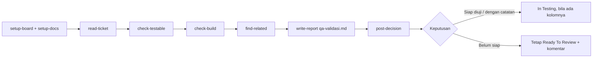

Validasi kesiapan uji satu atau lebih tiket (`$ARGUMENTS`). Peranmu = **Validator**; di mode tim kamu juga SPV validasi. Tidak menguji tiketnya, tidak menulis kode produk, tidak memindah tiket ke Done.

Baca dulu (jangan disalin ke sini): `~/.agent-workflow/qa-repo/skills/_shared/rules.md`, `tools.md`, `credentials.md`, `report-format.md`, `~/.agent-workflow/qa-repo/agents/qa-validator.md`; mode tim juga `agents/{qa-pdm,qa-contract-runner,qa-pjm}.md`. Skill internal = baca dan ikuti `~/.agent-workflow/qa-repo/skills/<nama>/SKILL.md` (Claude Code: boleh lewat tool Skill). Skill internal tidak saling memanggil; urutan ada di sini.

## Langkah
0. `export QA_WORKFLOW_DIR="$(cd ~/.agent-workflow/qa-repo && pwd -P)"`, lalu `AGENT_LOCK_PID=$PPID "$QA_WORKFLOW_DIR/bin/qa-mode.sh" qa on`.
1. **Sekali per sesi:** `setup-board`, `setup-docs`.
2. **Per tiket, berurutan** (satu laporan per tiket), folder kerja `${TMPDIR:-/tmp}/qa/<KODE>/validasi/`:
   1. `read-ticket` — tiket bukan Ready To Review/In Testing → lapor dan lewati.
   2. `check-testable` — AC terukur + hasil yang diharapkan.
   3. `check-build` — build/deploy tersedia, cocok dengan PR/MR, bukan produksi.
   4. `find-related` — tiket/PR/bug terbuka di area yang sama.
   5. Tulis `qa-validasi.md` dari template `~/.agent-workflow/qa-repo/templates/qa-validasi.md`, keputusan:
      | Kondisi | Keputusan |
      |---|---|
      | Semua AC terukur, build cocok, data ada | **Siap diuji** |
      | Build cocok, sebagian AC kabur atau data uji sebagian belum ada (bisa diuji sebagian) | **Siap dengan catatan** |
      | Build tidak ada/tidak cocok, AC inti kabur, atau lingkungan tidak bisa dipakai | **Belum siap** |
   6. `write-report` (`qa-check.py validasi` harus lolos) → link laporan.
   7. `post-decision` — komentar + In Testing bila ada kolomnya. Belum siap → tidak dikembalikan tanpa izin user.
3. **Mode** (`--solo`/`--tim` memaksa; tanpa flag: satu role dan AC sedikit = solo, selain itu tim). **Tim** menggantikan langkah 2.2–2.4: panggil teammate paralel (tool Agent, `name` dari tabel "Nama agen" di `rules.md`, `subagent_type` = nama agen `qa-<peran>`, `rules.md` → Orkestrasi):
   | Peran | Model | Skill | Hasil ke |
   |---|---|---|---|
   | PdM | `claude-sonnet-5-5` | `check-testable` | Validator |
   | Contract Runner | `claude-sonnet-5-5` | `check-build` + keberadaan contract | Validator |
   | PjM | `claude-sonnet-5-5` | `find-related` | Validator |
   Brief: KODE, ringkasan tiket (`tiket.md`), lokasi dokumen, folder `${TMPDIR:-/tmp}/qa/<KODE>/validasi/`. Prompt: "Ikuti `~/.agent-workflow/qa-repo/agents/<agen>.md`". Kamu menggabungkan hasilnya jadi satu `qa-validasi.md`, lalu langkah 2.6–2.7. Hentikan teammate yang tugasnya habis.
4. **Ringkasan akhir:**
   | KODE | Keputusan | Build | Link laporan |
   |---|---|---|---|
5. Hentikan semua teammate, lepas semua kunci, lalu `AGENT_LOCK_PID=$PPID "$QA_WORKFLOW_DIR/bin/qa-mode.sh" qa off` (panggilan Bash tersendiri).

## Berhenti lebih awal / galat
Hentikan teammate, lepas kunci, tulis bagian laporan yang sudah ada temuannya, `qa-mode.sh qa off`, lalu lapor posisi terakhir per tiket.
